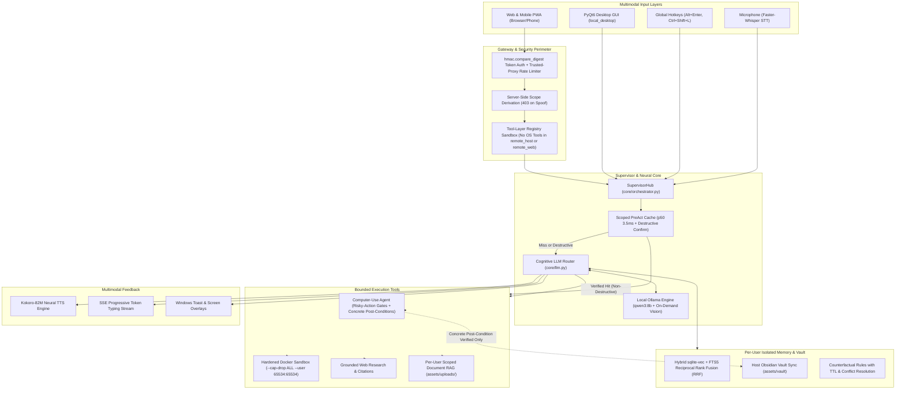

# Project LIBRA // System Architecture & Codebase Review
**Author & Lead Engineer:** Chuah Chen Xuan (Chen Xuan)  
**System Designation:** Project Libra — Local-First Autonomous Desktop Agent & Web Companion  
**Hardware Platform:** Local Workstation (NVIDIA GeForce RTX 5060 Ti, 16,311 MB VRAM, 31.8 GB RAM, Windows 11)  
**Repository:** [GitHub: REDACTED/LibraAi](https://github.com/REDACTED/LibraAi)

---

## Executive Engineering Summary & Measured Results

Project Libra is a local-first multimodal AI assistant and desktop automation agent running on a single consumer workstation (**NVIDIA GeForce RTX 5060 Ti 16GB**). It combines a floating PyQt6 desktop overlay for the local PC owner with an authenticated FastAPI remote web portal.

| Subsystem / Metric | Measured Result | Verification / Test Suite |
| :--- | :--- | :--- |
| **Primary Resident VRAM (`qwen3:8b` Q4\_K\_M + `nomic-embed-text` F16)** | **5,472 MB** (`qwen3:8b`) + **320 MB** (`nomic-embed-text`) = **5.79 GB** (leaves ~10.2 GB free VRAM on 16GB RTX 5060 Ti) | Live `/api/ps` & `SystemMonitor` telemetry |
| **On-Demand Vision Cold-Load Latency (`qwen2.5vl:7b`, `keep_alive=0`)** | **Median = `2,783.16 ms`** wall-clock (`2,593.39 ms` Ollama `load_duration`, 5 runs: `[5069.24, 2781.04, 2787.51, 2783.16, 2769.26] ms`) | 5-run cold-load benchmark (`keep_alive=0`) |
| **Generation Throughput (`qwen3:8b` on RTX 5060 Ti)** | **Median = `72.07 tok/s`** raw `eval_count / eval_duration` (`68.63 tok/s` end-to-end wall-clock over 10 runs; `58.6 – 62.3 tok/s` when streamed over SSE with UX pacing (sentence-level token flushing)) | `tests/test_web_sessions_and_tokens.py` & 10-run benchmark |
| **Promoted PreAct Macro Cache Hit Latency** | **`p50 = 3.32 ms`, `p95 = 3.98 ms`** SQLite lookup (`p50 = 3.53 ms`, `p95 = 4.27 ms` full `SupervisorHub.plan_or_execute` dispatch over `N = 100` runs) | `tests/test_phases_1_2_3.py` & 100-run benchmark |
| **Cognitive Router Accuracy (Labeled & Held-Out Benchmarks)** | **30 / 30 (100.0%)** on primary table (`tests/test_system_and_orchestrator.py`); **38 / 40 (95.0%)** raw untuned accuracy on 40-query casual/typo holdout set (`tests/router_holdout.py`) | `tests/test_system_and_orchestrator.py`, `tests/router_holdout.py` |
| **Remote Sandbox & Scope Enforcement** | **100% pass rate** across server-side scope spoofing (`HTTP 403`), `remote_host` & `remote_web` OS tool removal, per-user memory/upload isolation, and trusted-proxy rate limiting | `tests/test_email_auth_and_isolation.py` |

---

## 1. High-Level System Architecture

Project Libra uses a dual-interface architecture backed by a single local execution hub:
1. **Interactive Desktop GUI (`local_desktop` scope)**: A floating PyQt6 interface with wake-word activation (`Faster-Whisper`), screen OCR/vision, and OS automation running directly on Windows 11 for the workstation owner (`59` registered tools).
2. **Remote Web & Mobile PWA (`remote_host` / `remote_web` scopes)**: A FastAPI web portal featuring Server-Sent Events (SSE) token streaming, collapsible step-by-step thinking traces, and strict role-based tool sandboxing (`28` registered tools for `remote_host`, `21` registered tools for `remote_web`; neither remote scope registers any OS-control or terminal tools).
3. **Tunnel Provisioning Hierarchy (`web/server.py`)**: Based on `start_web_server_thread` in `web/server.py` (lines `5227–5238`) and `config.json` / `config.local.json`, the server provisions its public tunnel in the following order:
   - **Primary Tunnel (`ngrok`)**: Calls `ensure_ngrok_tunnel(server_port)` (`web/server.py`), which reads `ngrok.enabled`, `ngrok.authtoken`, and `ngrok.domain` from untracked `config.local.json` (falling back to `config.json`, where `ngrok.enabled` defaults to `false`). When enabled in `config.local.json`, it spawns `ngrok http --domain=<domain> <port>`.
   - **Automatic Fallback Tunnel (`Cloudflare Quick Tunnel`)**: If `ngrok` is disabled or fails to bind, `start_web_server_thread` calls `ensure_cloudflare_tunnel(server_port)` (`web/server.py`), which spawns `cloudflared.exe tunnel --url http://127.0.0.1:<port>` (`*.trycloudflare.com`).
   - **Header Identity Support**: `authenticate_request` (`web/server.py`) also accepts `Cf-Access-Authenticated-User-Email` (Cloudflare Access) and `Tailscale-User-Login` (Tailscale) identity headers if deployed behind either zero-trust proxy (TODO: confirm whether Cloudflare Access or Tailscale will replace `ngrok` in production).



---

## 2. Complete Codebase Directory Map

```text
LIBRA/
├── start_libra.bat               # One-click desktop launcher (launches GUI in background)
├── run_libra_debug.bat           # Debug launcher with interactive terminal console
├── LibraAi/
│   ├── config.json               # Sanitized default configuration (no secrets in git)
│   ├── config.local.json         # Untracked local secrets & tunnel credentials (gitignored)
│   ├── Dockerfile.sandbox        # Hardened non-root Docker image with scientific stack
│   ├── core/                     # Cognitive Core & Neural Coordination
│   │   ├── orchestrator.py       # SupervisorHub: tool-layer sandbox, scoped macro cache, routing
│   │   ├── llm.py                # LocalLLM: real-time-first router, prompt defenses, synthesis
│   │   ├── memory.py             # SemanticMemory: Hybrid sqlite-vec + FTS5 RRF, per-user isolation
│   │   ├── briefing.py           # Proactive daily briefing (weather, hardware vitals, calendar)
│   │   ├── folder_watchdog.py    # Automated file watchdog monitoring program folders
│   │   ├── game_discovery.py     # Dynamic game & application discovery engine
│   │   ├── kokoro_tts.py         # Kokoro-82M neural text-to-speech
│   │   ├── model_manager.py      # Dynamic VRAM model loader & SoM locator
│   │   ├── persona.py            # Dynamic personality traits & tone management
│   │   ├── research.py           # Multi-query web scraper & citation verifier
│   │   ├── scheduler.py          # Windows 11 toast notification & reminder scheduler
│   │   ├── scratchpad.py         # Multi-step AgentScratchpad for compound commands
│   │   ├── skill_forge.py        # Hermes Skill Forge: Docker-sandboxed skill execution
│   │   ├── stt.py                # Faster-Whisper GPU-accelerated speech-to-text
│   │   ├── vram_governor.py      # VRAM Governor & Anti-Cheat Gaming Shield
│   │   └── wakeword_booster.py   # Continuous wake-word detector
│   ├── tools/                    # Hardware & Operating System Automation Tools
│   │   ├── computer_use_agent.py # Bounded ReAct desktop agent with risky-action gates & post-conditions
│   │   ├── file_manager.py       # Voidtools Everything search, file creation & inspection
│   │   ├── gui_control.py        # PyAutoGUI automation with kernel anti-cheat safety lock
│   │   ├── data_scientist.py     # Autonomous data analysis via Docker sandbox
│   │   ├── repl_runner.py        # PersistentDataREPL with hardened Docker container isolation
│   │   ├── document_rag.py       # PDF, CSV, Word & text file RAG with per-user upload isolation
│   │   ├── security_scanner.py   # Multi-layer file hash & Defender scanner
│   │   ├── spotify_agent.py      # Local Spotify playback & search controller
│   │   ├── weather.py            # Open-Meteo live weather data & UV indexing
│   │   └── window_context.py     # Active foreground window & running game detector
│   ├── ui/                       # Desktop Interface
│   │   ├── gui.py                # PyQt6 desktop GUI with animated orb & system tray
│   │   ├── memory_vault_widget.py# GUI visual memory vault & lesson viewer
│   │   └── spotlight_bar.py      # Quick command bar (Alt+Enter)
│   ├── web/                      # Remote Web Agent & Mobile PWA
│   │   ├── server.py             # FastAPI server, server-side scope guard, trusted-proxy rate limiting
│   │   └── static/               # Web Client
│   │       ├── index.html        # Web UI layout & modals
│   │       ├── app.js            # Frontend state, collapsible thought trace, audio queue
│   │       ├── style.css         # Responsive desktop & mobile styling
│   │       └── sw.js             # PWA service worker
│   ├── assets/                   # Persona, Learned Vault & Knowledge
│   │   ├── SOUL.md               # Core identity & directives
│   │   ├── LESSONS.md            # Host counterfactual operational lessons
│   │   └── vault/                # Host Obsidian-compatible markdown memory notes
│   └── tests/                    # Automated Unit, Security & Regression Test Suites
│       └── router_holdout.py     # 40-query casual/typo held-out router benchmark
```

---

## 3. Core Architectural Pillars

### Pillar 1: SupervisorHub, Tool-Layer Sandbox & Scoped Macro Cache
**File:** `core/orchestrator.py`

The `SupervisorHub` (`core/orchestrator.py`) coordinates all requests from the desktop GUI, voice pipeline, and remote web server.

- **Tool-Layer Sandbox (`get_registered_tools`)**:
  - `local_desktop` (`59` tools): Full workstation toolset including OS-control, GUI automation, and Skill Forge.
  - `remote_host` (`28` tools): Host connected remotely over the web tunnel. All OS-control, file-mutation, GUI-automation, and skill-creation tools (`open_app`, `close_app`, `create_file`, `create_folder`, `gui_action`, `computer_use_agent`, `shutdown`, `create_skill`, `run_learned_skill`, `virus_scan`, `workspace_macro`, `spotify_action`, `media_action`, `clipboard_copilot`) are strictly `local_desktop`-only and are never registered for `remote_host`.
  - `remote_web` (`21` tools): Tester/Guest sessions (`chat`, `clarify`, `compare_candidates`, `currency_convert`, `deep_research`, `document_rag`, `forget_memory`, `list_skills`, `lookup_entity`, `math_eval`, `ping_check`, `place_detail`, `places_search`, `profile_recall`, `recall_memory`, `remember_fact`, `time`, `unit_convert`, `weather`, `web_search`, `world_time`). Host-specific `daily_briefing` and hardware vitals (`system_status` and `/api/vitals`) are excluded from `remote_web`.
- **Scoped PreAct Macro Cache (`p50 = 3.53 ms`, `p95 = 4.27 ms`)**: Macro cache keys include `client_scope` (`macro:{client_scope}:{norm_trigger}`). In addition, `_execute_macro_chain` (`core/orchestrator.py`) refuses OS tools whenever `client_scope != "local_desktop"`.
- **Mandatory Destructive Action Confirmation**: Even when a macro is cached, any chain containing destructive actions (`delete`, `remove`, `send`, `install`, `uninstall`, `shutdown`, `format`, `kill`) returns `status="confirmation_required"` and requires explicit user confirmation before execution.

---

### Pillar 2: Real-Time-First Cognitive Router & Held-Out Benchmark
**Files:** `core/llm.py`, `tests/test_system_and_orchestrator.py`, `tests/router_holdout.py`

The `LocalLLM` (`core/llm.py`) router evaluates queries in strict priority order so mixed prompts (e.g. *"hey how are you, what's the bitcoin price right now"*) never get swallowed by greeting patterns:
1. **Real-Time Signals Checked First**: Checks `realtime_signals` (breaking news, sports leagues, live scores, crypto/stock prices) and `temporal_news_signals` (`news today`, `what happened today`) before chitchat.
2. **Bounded Chitchat Guard (`<= 8` words)**: Only classifies an input as conversational `chat` via fast-path if `len(cleaned_query.split()) <= 8`, `not has_realtime`, and a greeting/well-being pattern matches.
3. **Measured Router Accuracy**:
   - **Primary 30-Query Table (`tests/test_system_and_orchestrator.py`)**: **30 / 30 (100.0%)** across chitchat, real-time, and mixed queries.
   - **Held-Out 40-Query Casual/Typo Benchmark (`tests/router_holdout.py`)**: **38 / 40 (95.0%)** raw accuracy on unseen casual queries with typos and slang (evaluated once without tuning the router).
4. **Source Citation Discipline**: Citations are attached only when `web_search` or `document_rag` actually retrieves external documents, preventing unrelated citations on conversational prompts.

---

### Pillar 3: Bounded Computer-Use Agent, Risky-Action Gates & Concrete Post-Condition Verification
**Files:** `tools/computer_use_agent.py`, `tools/gui_control.py`, `config.json`

The `AutonomousComputerUseAgent` (`tools/computer_use_agent.py`) executes multi-step GUI workflows (`local_desktop` only) with layered safety checks:
- **Argument-Level Risky-Action Gates (`check_action_risk`)**: In addition to the verb allowlist (`ALLOWED_AGENT_ACTIONS`), `check_action_risk` inspects arguments for `type`, `press`, `hotkey`, `navigate`, and `click`, halting and returning `status="confirmation_required"` before any GUI action is executed when a step involves:
  1. `Win+R` or `Win` key system launchers (`win`, `lwin`, `rwin`, `win+r`).
  2. Opening or typing into a terminal / PowerShell / `cmd.exe` / `wt.exe` / `wsl`.
  3. Downloading or running executables/scripts (`.exe`, `.msi`, `.bat`, `.cmd`, `.ps1`, `.vbs`, `.scr`, `.jar`, `.reg`, `download`, `installer`, `setup`, `payload`).
  4. Typing into password, credential, secret, OTP, or API key fields.
  5. Navigating to a domain not on the `computer_use.allowed_domains` allowlist in `config.json`.
- **Concrete Post-Condition Verification (`_verify_end_state`)**: Before `_save_learned_workflow` caches any workflow to `assets/vault/` or the PreAct macro cache, `_verify_end_state` requires a concrete `post_condition` dictionary (`expected_title`, `expected_url`, or `expected_screen_text`) and verifies it against the live window title, CDP browser URL, and OCR/UIAutomation screen text. Workflows without a defined post-condition or with a non-matching terminal state return `status="unverified"` (`learned_workflow_saved=False`) and are never saved to the vault.
- **Bounded Retries & Escalation (`MAX_CONSECUTIVE_FAILURES = 3`)**: After 3 consecutive action failures, the loop exits early with `status="needs_help"`.
- **Secondary Screen-Text Sanitization**: `sanitize_untrusted_screen_text()` strips prompt-injection strings from OCR/DOM text as a secondary defense layer.

---

### Pillar 4: Hybrid `sqlite-vec` + `FTS5` Reciprocal Rank Fusion (RRF) & Per-User Isolation
**Files:** `core/memory.py`, `tools/document_rag.py`

- **Hybrid Vector + Lexical Recall via RRF**: `SemanticMemory.recall_relevant` (`core/memory.py`) runs dense cosine KNN search on `vec_facts` (`sqlite-vec` with 768-dim `nomic-embed-text`) alongside BM25 full-text search on `facts_fts` (`FTS5`), merging both ranked lists using Reciprocal Rank Fusion:
  $$\text{RRF\_Score}(d) = \frac{1}{k + \text{rank}_{\text{vec}}(d)} + \frac{1}{k + \text{rank}_{\text{fts}}(d)}, \quad k = 60$$
- **Cross-Device Access Scope Clarification**: The SQLite database (`assets/libra_memory.db`) and Obsidian Markdown files (`assets/vault/`) reside locally on the host workstation. Cross-device continuity applies when connecting to the host workstation through the authenticated FastAPI web portal.
- **Strict Per-User Namespace Isolation (`user:<email>:*`)**: In `remote_web`, `remember_fact`, `recall_memory`, and `forget_memory` operate exclusively within the authenticated user's namespace (`category LIKE 'user:<email>:%'` and `LOWER(user_email) = <email>`), never reading, modifying, or deleting the Host's facts, `assets/vault/`, or `assets/LESSONS.md`.
- **Per-User Scoped `document_rag`**: In remote scopes (`remote_web` and `remote_host`), `DocumentRAG.query_document` (`tools/document_rag.py`) rejects any path containing `..` traversal components and restricts file access to files uploaded by that specific user inside `assets/uploads/<sanitized_email>/`.

---

### Pillar 5: VRAM Residency, Model-Swap Latency & Anti-Cheat Gaming Shield
**Files:** `core/vram_governor.py`, `tools/gui_control.py`

- **Measured VRAM Residency & Cold-Load Latency**:
  - `qwen3:8b` (`Q4_K_M`, primary router + chat): **5,472 MB VRAM** (`keep_alive="15m"`).
  - `nomic-embed-text` (`F16`, embeddings): **320 MB VRAM** (`keep_alive="60m"`).
  - `qwen2.5vl:7b` (vision grounding): loaded on demand with `keep_alive=0`, with a measured 5-run median cold-load latency of **`2,783.16 ms`** wall-clock (`2,593.39 ms` Ollama `load_duration`), releasing its ~5.2 GB VRAM immediately after inference.
- **VRAM Auto-Governor & Kernel Anti-Cheat Input Lock**: While kernel anti-cheat processes (`vgk.exe`, `valorant.exe`, `easyanticheat.exe`, `battleye`, `ricochet`, `faceit`) or Gaming Shield mode are active, `GUIControlAgent` disables synthetic `PyAutoGUI` mouse/keyboard injection (`status="paused_for_anticheat"`).

---

### Pillar 6: Hardened FastAPI Remote Web Agent & Docker Sandbox
**Files:** `web/server.py`, `tools/repl_runner.py`, `core/skill_forge.py`, `Dockerfile.sandbox`

- **Constant-Time Token Comparison (`hmac.compare_digest`)**: Master access tokens, per-user unique tokens, guest invite token SHA-256 digests, and verification codes are compared using `hmac.compare_digest` in `web/server.py` and `core/memory.py`.
- **Trusted-Proxy Rate Limiting (`_resolve_client_ip`)**: Sliding-window rate limiting on `/api/chat` and `/api/auth/send-code` extracts the client IP from `Cf-Connecting-IP` / `X-Forwarded-For` **only** when the TCP connection originates from a trusted local tunnel/proxy (`127.0.0.1`, `::1`, `localhost`), preventing direct clients from spoofing proxy headers to bypass rate limits.
- **Hardened Docker Sandbox**: `PersistentDataREPL.run_in_docker_sandbox` (`tools/repl_runner.py`) and `SkillForge.execute_in_docker_sandbox` (`core/skill_forge.py`) execute generated Python code with:
  ```text
  docker run --rm --network none --cap-drop ALL --security-opt no-new-privileges \
    --memory 256m --cpus 1 --pids-limit 128 --user 65534:65534 --read-only \
    --tmpfs /tmp:rw,noexec,nosuid,size=64m -e MPLCONFIGDIR=/tmp -e HOME=/tmp -i <image>
  ```
  with zero writable host volume mounts. Because stock `python:3.11-slim` does not bundle `numpy`, `pandas`, `matplotlib`, `seaborn`, or `scikit-learn`, `Dockerfile.sandbox` defines a minimal non-root image (`libra-sandbox:3.11`) pre-installing those libraries at image build time while keeping `--network none` at runtime.

---

## 4. Threat Model & Security Boundaries

| Threat Vector | Trust Boundary | Mitigation Implemented | Regression Test |
| :--- | :--- | :--- | :--- |
| **Remote Privilege Escalation (`client_scope` spoofing)** | HTTP/JSON request body at `/api/chat`, `/api/sessions/new`, `/api/voice` | `client_scope` is derived server-side from the authenticated token; any remote request specifying `local_desktop` is rejected with `HTTP 403`. | `test_10_server_side_client_scope_and_403_on_local_desktop_spoof` |
| **Remote OS Command Execution (`remote_host` & `remote_web`)** | `SupervisorHub.get_registered_tools` & `LocalLLM.plan` | OS-control and terminal tools are `local_desktop`-only (`remote_host` and `remote_web` cannot call `open_app`, `close_app`, `create_file`, `create_folder`, `gui_action`, `computer_use_agent`, `shutdown`, `create_skill`). | `test_14_round2_item_a_remote_scope_restrictions` |
| **Cross-User Memory, `document_rag` & Vitals Exposure** | `SemanticMemory`, `DocumentRAG`, `/api/vitals` | `remote_web` memory tools only touch `user:<email>:*`; `document_rag` rejects `..` and restricts remote users to `assets/uploads/<email>/`; `daily_briefing` & `/api/vitals` are blocked for `remote_web`. | `test_14_round2_item_a_remote_scope_restrictions` |
| **Risky Computer-Use Arguments & Unverified Vault Caching** | `AutonomousComputerUseAgent.check_action_risk` & `_verify_end_state` | Requires `confirmation_required` for `Win+R`/`Win` keys, terminals, downloads/executables, password fields, and unallowlisted domains; requires a concrete matching `post_condition` before saving to `assets/vault/`. | `test_round2_item_b_risky_action_gates`, `test_round2_item_c_concrete_post_condition_verification` |
| **Container Escape / Writable Host Mounts in Code Sandbox** | `PersistentDataREPL` & `SkillForge` | Enforces `--network none`, `--cap-drop ALL`, `--security-opt no-new-privileges`, `--pids-limit 128`, `--user 65534:65534`, `--read-only`, `--tmpfs /tmp`, and zero host mounts. | `test_15_round2_item_d_docker_sandbox_hardening` |
| **Timing Side-Channels & `X-Forwarded-For` Rate-Limit Spoofing** | `authenticate_request`, `MemoryCore`, `_resolve_client_ip` | Compares tokens via `hmac.compare_digest`; trusts `X-Forwarded-For` / `Cf-Connecting-IP` only when the peer socket is a trusted proxy. | `test_16_round2_item_e_hmac_and_trusted_proxy_rate_limit` |

---

## 5. Known Limitations

1. **Single-Workstation Local Storage**: The SQLite database (`assets/libra_memory.db`), Obsidian vault (`assets/vault/`), and local Ollama models reside on the host PC. If the host PC is powered off or asleep, the remote web portal is unreachable.
2. **Docker Desktop & Custom Sandbox Image Requirement**: Autonomous data science scripts (`data_scientist.py`) and custom Python skills (`skill_forge.py`) require a running local Docker daemon. Because `python:3.11-slim` does not include `pandas` or `matplotlib`, the host must build `Dockerfile.sandbox` (`docker build -f Dockerfile.sandbox -t libra-sandbox:3.11 .`) for scientific imports inside the offline container.
3. **Anti-Cheat Input Restrictions**: By design, synthetic mouse and keyboard automation (`PyAutoGUI`) is disabled whenever kernel anti-cheat games are running.
4. **Bounded Computer-Use Retries & Concrete Post-Conditions**: Multi-step GUI workflows without an explicit `post_condition` execute on `local_desktop` when safe, but are marked `status="unverified"` and are not cached into `assets/vault/`.
