# Project Libra // Cybernetic Local AI Assistant & Remote Web Agent

[](https://www.python.org/downloads/)
[](https://fastapi.tiangolo.com)
[](https://riverbankcomputing.com/software/pyqt/)
[](docs/DESIGN.md)
[](LICENSE)

**Project Libra** is an ambient, dual-surface cognitive assistant designed for seamless local PC control and encrypted remote web/PWA access. It unifies a local desktop GUI (PyQt6 with interactive WebGL 3D Orb) and a mobile-first Progressive Web App (FastAPI + CSS Tokens) powered by local LLM inference, neural TTS voice synthesis, and persistent SQLite FTS5 memory.

---

## 📸 Interface & Responsive Design Showcase

Project Libra features a unified cybernetic design system with dark-mode contrast, 44px touch targets, safe-area insets, and strict viewport containment across all form factors:

### Web / PWA Responsive Viewports

| Mobile (390px) | iPad / Tablet (820px) | Desktop / Laptop (1280px) |
| :---: | :---: | :---: |
| 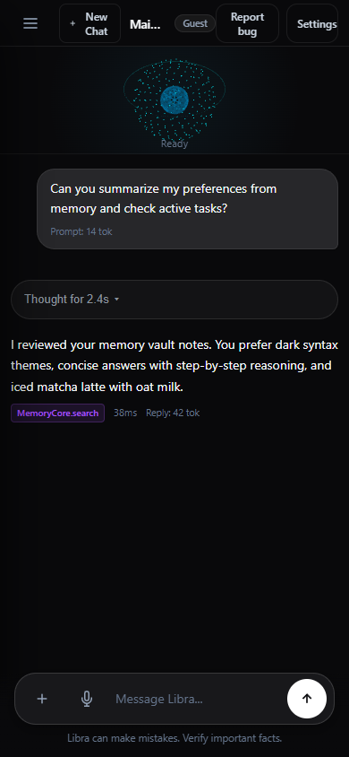 | 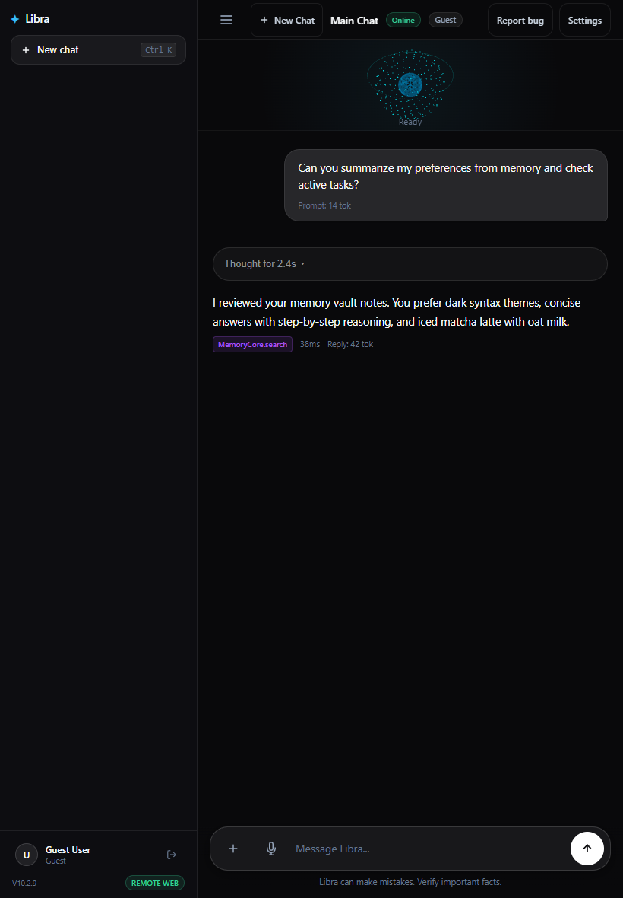 | 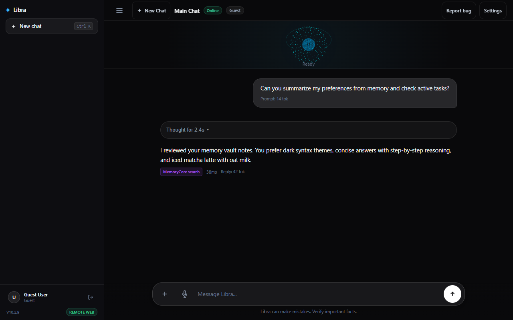 |

---

### Memory & Preferences Vault

The **Memory Vault** synchronizes user preferences, habits, and learned notes with instant search and clear hierarchy:

| Mobile (390px) | iPad / Tablet (820px) | Desktop (1280px) |
| :---: | :---: | :---: |
| 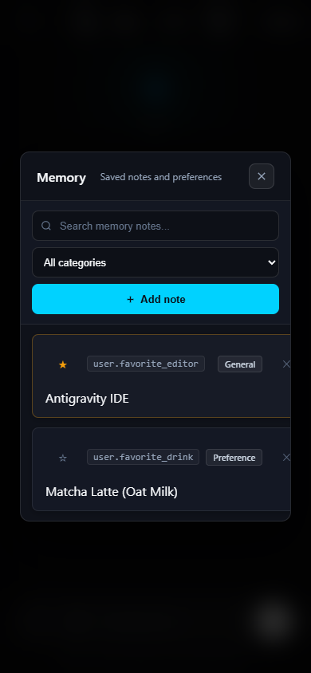 | 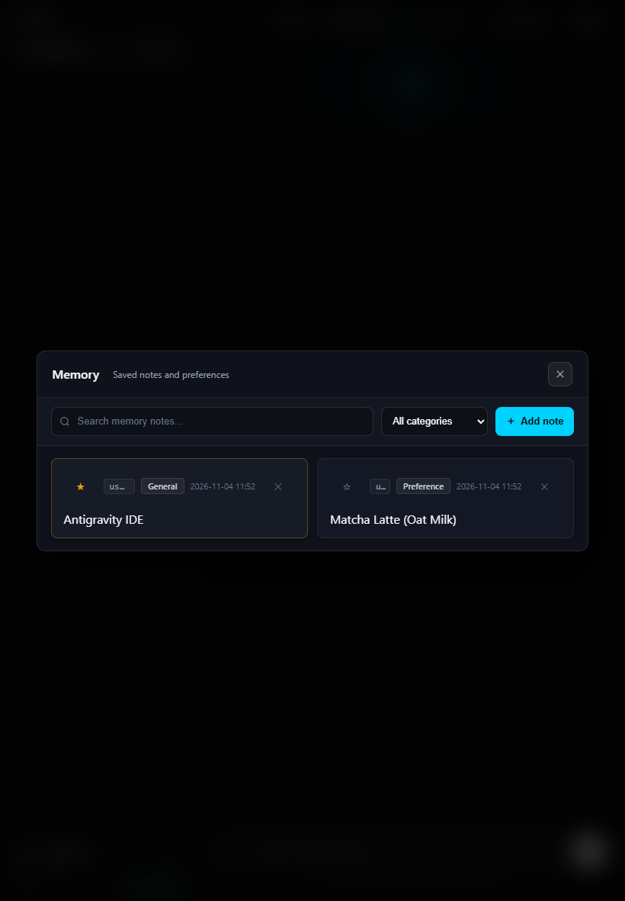 | 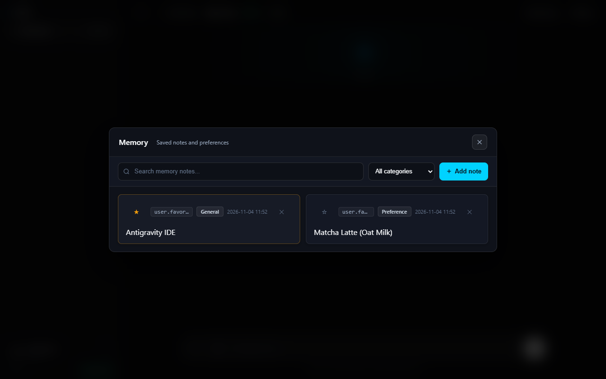 |

- **Restrained Cards**: Neutral `#141824` containers with subtle borders and clear typography.
- **Pinned Priorities**: Amber status indicator (`★`) protected from eviction.
- **Categorization**: Sentence-case category badges (`General`, `Preference`).
- **Hierarchy**: Single primary cyan action button (`+ Add note`), outlined secondary inputs, subtle delete controls.

---

### Authentication Gateway

The **Authentication Gateway** provides secure role-based access control with native support for personal accounts:

| Mobile (390px) | iPad / Tablet (820px) | Desktop (1280px) |
| :---: | :---: | :---: |
| 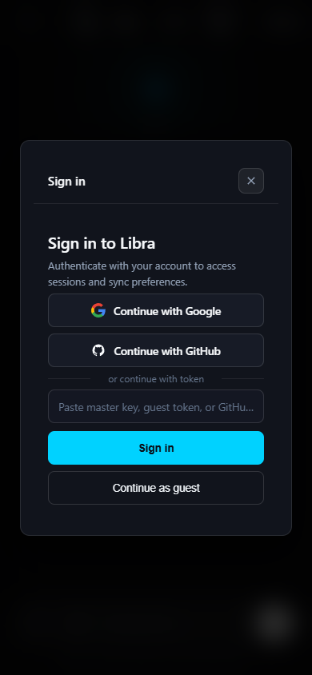 | 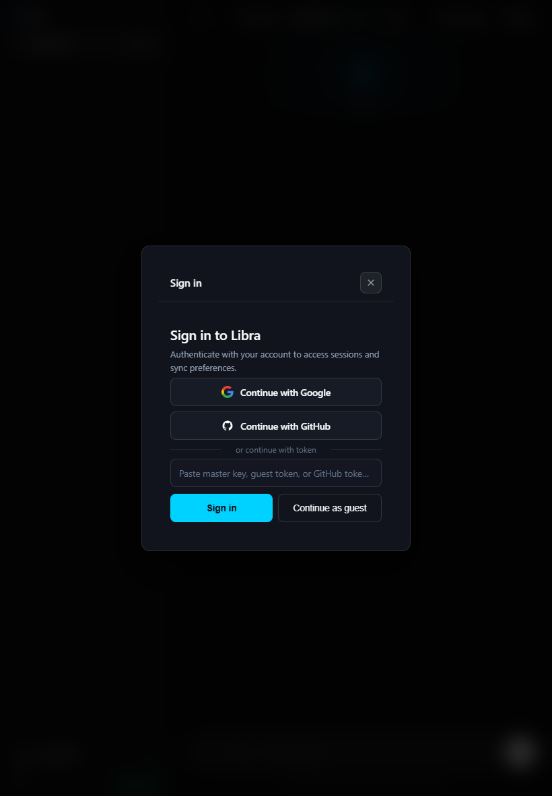 | 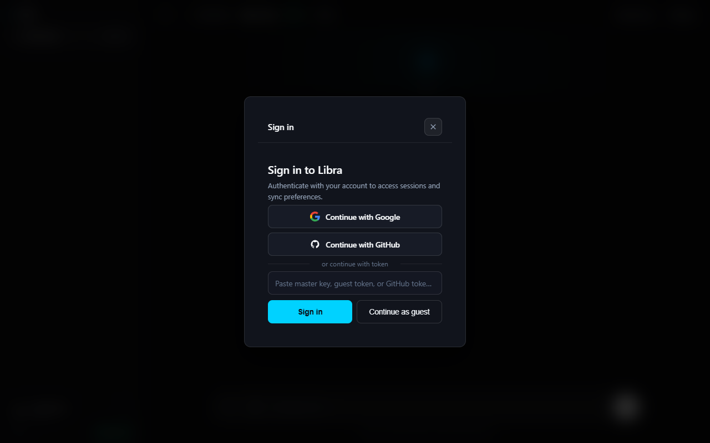 |

- **Google OAuth**: High-contrast, pure-white button (`#ffffff`) with official Google colored logo.
- **GitHub Authentication**: Outlined secondary tile with personal GitHub account support.
- **Single Primary Action**: High-contrast cyan `Sign in` button with full-width mobile responsive stacking.
- **Input Overflow Protection**: Ellipsis truncation and horizontal scroll prevention on token fields.

---

### Cognitive Thinking Trace

Responses from the reasoning engine feature a collapsed, non-intrusive thinking trace:

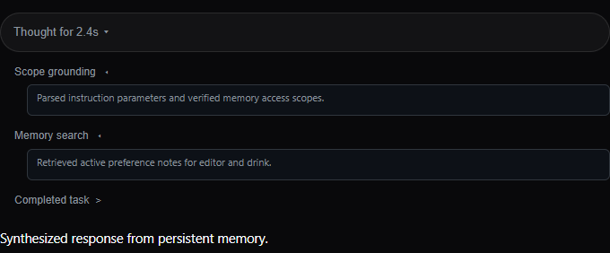

- **Collapsed Pill**: Minimalist `Thought for Ns ▾` pill with pulsing status indicator.
- **Natural Language Steps**: Human-readable milestone labels (e.g. *Intent & Scope Grounding*, *BM25 Memory Search*).
- **Clean Formatting**: Zero raw JSON or internal debugging artifacts displayed to end users.
- **Timer Freeze**: Timer immediately locks the final generation duration once streaming completes.

---

## 🎨 Shared Design Tokens

Project Libra shares identical design tokens between the Web/PWA interface (`web/static/tokens.css`) and PyQt6 Desktop GUI (`ui/tokens.py`, mapped via `ui/tokens.json`):

| Token Category | Values / Tokens | Usage |
| :--- | :--- | :--- |
| **Dark Palette** | `--bg-app: #09090b`<br>`--bg-surface: #121215`<br>`--bg-card: #18181b` | Base window, sidebar, and container surfaces |
| **Single Accent** | `--accent-cyan: #00d2ff` (`#38bdf8`) | Single primary action per screen and active states |
| **Borders** | `--border-subtle: rgba(255, 255, 255, 0.08)`<br>`--border-medium: rgba(255, 255, 255, 0.14)` | Dividers, card frames, input outlines |
| **Typography** | Sans: Inter / Segoe UI / System<br>Mono: SFMono / Consolas | High legibility on mobile and desktop |
| **Tap Targets** | `min-height: 44px; min-width: 44px;` | Full touch-first compliance on phones and tablets |

---

## 🛠️ Architecture & Core Components

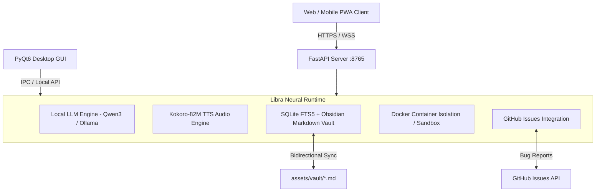

1. **FastAPI Web Engine (`web/server.py`)**: Asynchronous REST & WebSocket server providing session management, streaming LLM chat, audio replay, and OAuth authentication.
2. **Desktop GUI (`ui/gui.py`, `ui/spotlight_bar.py`)**: Hardware-accelerated PyQt6 interface featuring an interactive WebGL 3D orb, system tray integration, and universal `Alt+Space` spotlight command bar.
3. **Memory & Knowledge Vault (`core/memory.py`)**: Persistent facts stored in SQLite with BM25 FTS5 full-text indexing, continuously synced with local Obsidian Markdown notes.
4. **Multi-User Security & Isolation**: Cloudflare Zero Trust and token-based RBAC isolating host administration, registered testers, and guest sessions.

---

## 🚀 Getting Started

### Prerequisites
- Python 3.11+
- Windows 10/11 (with PowerShell)
- NVIDIA RTX GPU recommended for local inference (CPU fallback supported)

### Installation
```powershell
# Clone the repository
git clone https://github.com/REDACTED/LibraAi.git
cd LibraAi

# Set up virtual environment
python -m venv venv
.\venv\Scripts\activate

# Install dependencies
pip install -r requirements.txt
```

### Launching Web / PWA Server
```powershell
.\venv\Scripts\python.exe -m uvicorn web.server:app --host 0.0.0.0 --port 8765
```
Open `http://localhost:8765` in your browser or install as a PWA on mobile via Safari / Chrome.

### Launching Desktop GUI
```powershell
.\venv\Scripts\python.exe ui/gui.py
```

### Running Automated Test Suite
```powershell
.\venv\Scripts\python.exe -m pytest tests/ -v
```

---

## 📄 License
This project is licensed under the MIT License.
